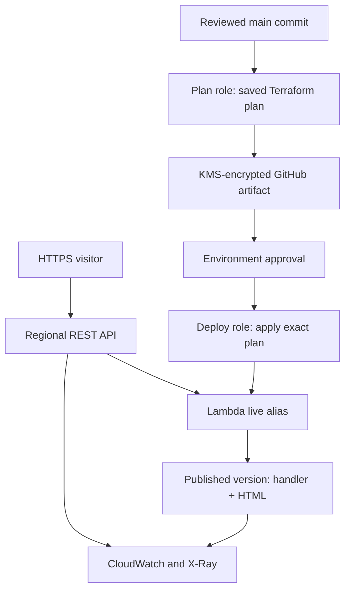

# AWS Serverless Page Delivery with Terraform and GitHub Actions

An independent lab that publishes a Git-managed HTML page through **API Gateway
and a Python Lambda function**. Terraform provisions the infrastructure, GitHub
Actions reviews and deploys immutable releases, and AWS operations use the CLI.

**Current status:** implementation and automated checks are being prepared for
review. AWS deployment and live lifecycle validation have not yet been completed.
See [validation evidence](docs/validation.md) before treating any control as verified.

## What this demonstrates

- Package `content/index.html` with a Lambda release; serve the version that was reviewed.
- Regional REST API, published Lambda versions and a stable `live` alias.
- Separate bootstrap and application Terraform, encrypted remote state and native S3 locking.
- Narrow plan/deploy roles, environment-specific runtime roles and GitHub OIDC without static AWS keys.
- Pull request checks, required change controls, deliberate deployment approval and exact saved-plan apply.
- KMS-encrypted plan artifacts, current-main and plan-age checks, dev verification before prod promotion.
- Structured access logs, tracing, alarms, HTTP smoke checks and a guarded teardown workflow.

## Architecture



Lambda reads the file packaged with its deployment. It does not fetch a GitHub
file on every request, need a repository token, or depend on GitHub availability
to serve the page. API Gateway invokes the numbered release behind the alias.

## Repository layout

| Path | Purpose |
| --- | --- |
| `content/` | Public demonstration page |
| `app/` | Standard-library-only Lambda handler |
| `infrastructure/bootstrap/` | State, KMS, IAM, API containers and logging prerequisites |
| `infrastructure/app/` | Function, alias, routes, stages, logs and alarms |
| `.github/workflows/` | CI, saved-plan deploy/destroy and safe OIDC claim inspection |
| `scripts/` | Deterministic build, release guards, plan encryption, GitHub configuration and smoke tests |
| `tests/` | Packaged-handler and release-control tests |

## Start here

1. Read [the design](docs/design.md) and [control matrix](docs/controls.md).
2. Review and merge the implementation through a pull request.
3. Follow [CLI setup and deployment](docs/runbook.md), including GitHub protection verification.
4. Validate the full deploy/change/rollback/destroy lifecycle and record sanitized evidence.

The default region is `eu-west-2`, matching the earlier personal Terraform lab.
There is no requirement to use the AWS Console. Terraform is pinned to **1.16.5**,
the AWS provider to **6.67.0**, and Lambda to the supported **Python 3.13** runtime.
GitHub Actions are pinned to commit SHAs. Dependabot proposes updates through PRs.

For local application checks:

```powershell
python -m venv .venv
.venv\Scripts\python -m pip install -r requirements-release.txt
.venv\Scripts\python -m unittest discover -s tests -v
.venv\Scripts\python scripts/build.py --commit (git rev-parse HEAD)
terraform fmt -check -recursive
```

Linux/macOS can use `.venv/bin/python` for the same Python commands.

## Scope and production readiness

This is a public-content lab with separate dev/prod state and identities in one
personal AWS account. Solo self-review and self-approved deployments are explicit
choices. They do not provide enterprise separation of duties. Production needs
independent reviewers, separately owned AWS accounts, operational notifications,
account audit controls, budget alerts and a validated recovery exercise.

API throttles and reserved concurrency bound traffic; they are not spending caps.
KMS keys, detailed metrics, logs and API traffic can incur charges. Application
destroy deliberately retains bootstrap state, keys, identities and API containers.
See [operations and costs](docs/operations.md).

This project is part of the [portfolio lab roadmap](docs/portfolio-roadmap.md).
