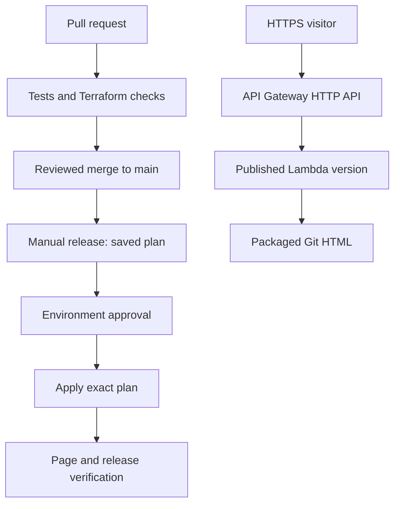

# AWS Serverless Page CI/CD

An independent portfolio lab by **Eranda Welgama**: publish a Git-managed HTML page through **API Gateway → Lambda**, provision AWS with **Terraform**, and release changes through **GitHub Actions**.

**Current setup choice:** keep the repository private on GitHub Free and defer approval controls. Use [private lab mode](docs/private-lab.md), which offers manual plan/deploy/destroy runs without GitHub environments. The reviewed release design described below remains available for later adoption; its approval controls are not active in private lab mode.

**Status:** implementation and credential-free validation are complete. AWS bootstrap, repository controls and a live deployment must be completed using [the setup guide](docs/setup.md). This repository demonstrates production practices; it is not a claim of a production service or certification.

The source page lives in [`content/index.html`](content/index.html). CI packages it together with a Python handler and a release manifest. Lambda reads the packaged file and returns `text/html` through an HTTP API. It needs neither a GitHub credential nor an outbound request to GitHub.

| Practice | Implementation |
|---|---|
| Infrastructure as code | Separate bootstrap and application Terraform roots; no AWS Console setup |
| Temporary credentials | GitHub OIDC, exact repository/environment subjects, separate plan/deploy roles |
| Change review | PR template, CODEOWNERS, required checks, stale review dismissal, protected `main` |
| Deployment approval | Protected `production` environment; plan runs first using `production-plan` |
| Review fidelity | Apply the saved binary plan from the same workflow run; six-hour expiry and current-main check |
| State protection | Private encrypted S3, versioning, TLS-only access and native S3 lock files |
| Application security | Read-only routes, fixed packaged file, CSP, HTTPS response headers and bounded concurrency |
| Observability | JSON access/function logs, 30-day retention, Lambda/API error alarms and an SNS topic |
| Supply chain | Actions pinned to full commit SHAs, provider locks, Dependabot, dependency-free Lambda |
| Recovery | Git revert followed by a new reviewed release; explicit guarded destroy workflow |

Start with [setup](docs/setup.md), then use the [operating guide](docs/operations.md). [Security controls](docs/security.md) explains what is enforced, what requires account configuration, and the lab's limits. [Validation](docs/validation.md) records the evidence. [Portfolio roadmap](docs/portfolio-roadmap.md) keeps the remaining projects ahead of website construction.

Region: **eu-west-2**. The anonymous public page contains only demonstration content. `production` is a deployment environment name for this lab.

