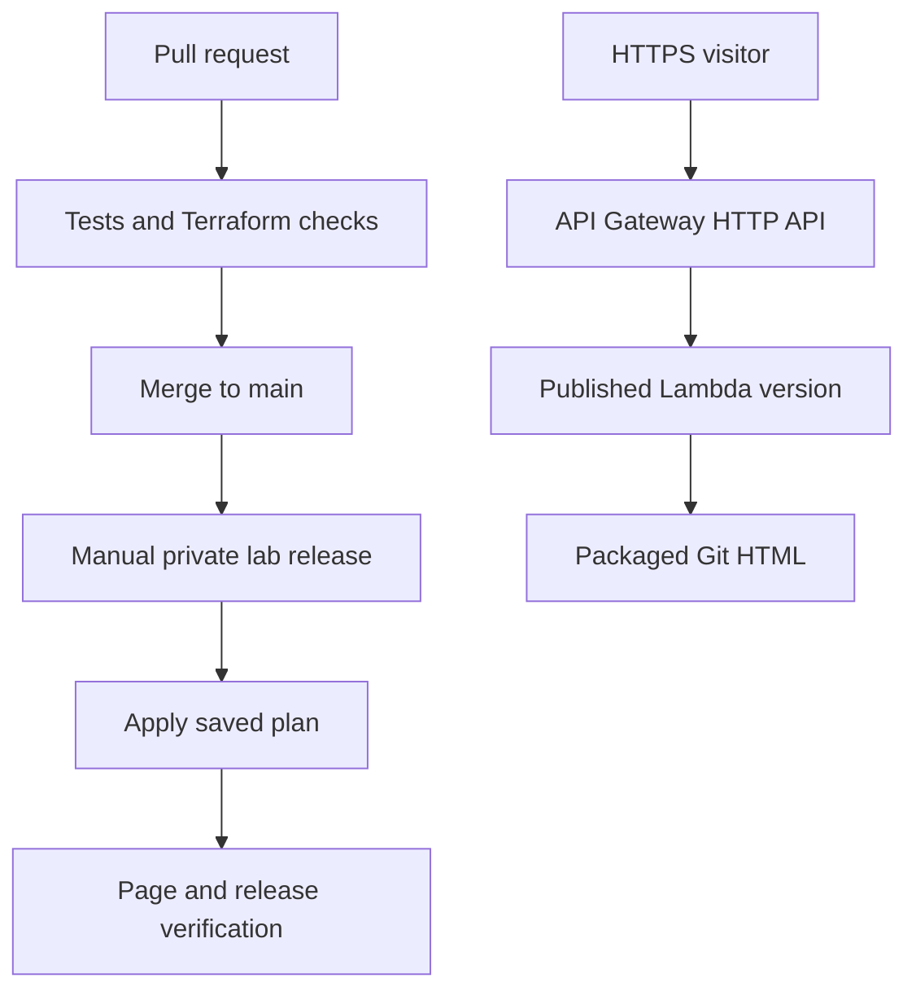

# AWS Serverless Page CI/CD

An independent portfolio lab by **Eranda Welgama**: publish a Git-managed HTML page through **API Gateway → Lambda**, provision AWS with **Terraform**, and release changes through **GitHub Actions**.

**Current setup choice:** keep the repository private on GitHub Free and defer approval controls. Use [private lab mode](docs/private-lab.md), which offers manual plan/deploy/destroy runs without GitHub environments. The reviewed release design described below remains available for later adoption; its approval controls are not active in private lab mode.

**Status:** initial deployment, log delivery, rollback, and alarm email delivery were verified on **2026-10-08**. After manual deletion of bootstrap resources, Terraform recovered the API Gateway and SNS topic on **2026-10-11**. The application was redeployed successfully, and a new HTML page update was published through PR #10 and GitHub Actions, with the live page and health response matching commit `9fe3f162aa945e313c005d89dde78b9e01f6e136`. Bootstrap state remains in S3; the workflow verifies the exact Git HTML and release SHA and confirms infrastructure convergence. The previous email subscription was lost when the SNS topic was deleted and must be recreated and verified. Application teardown remains to test. [Deployment evidence](docs/validation.md) records what passed and what remains to test. This is an independent portfolio lab.

[Open the demonstration page](https://2auiwp9odb.execute-api.eu-west-2.amazonaws.com/) · [Latest verified release](https://github.com/reranda/aws-serverless-page-cicd/actions/runs/38148490686)

The source page lives in [`content/index.html`](content/index.html). CI packages it together with a Python handler and a release manifest. Lambda reads the packaged file and returns `text/html` through an HTTP API. It needs neither a GitHub credential nor an outbound request to GitHub.

| Practice | Implementation |
|---|---|
| Infrastructure as code | Separate bootstrap and application Terraform roots; no AWS Console setup |
| Temporary credentials | GitHub OIDC, exact repository/main-branch subject, separate plan/deploy roles |
| Change process | PR template, CODEOWNERS and CI on PRs/main; enforced approvals and branch protection deferred in private lab mode |
| Deployment control | Manual plan-only/deploy/destroy runs; protected environments available in the separate reviewed mode |
| Plan fidelity | Apply the saved binary plan from the same workflow run; six-hour expiry and current-main check |
| State protection | Private encrypted S3, versioning, TLS-only access and native S3 lock files |
| Application security | Read-only routes, fixed packaged file, CSP, HTTPS response headers and bounded concurrency |
| Observability | JSON access/function logs, 30-day retention, Lambda/API error alarms and SNS; both alarm email paths verified before the SNS topic was deleted; replacement subscription pending |
| Supply chain | Actions pinned to full commit SHAs, provider locks, Dependabot, dependency-free Lambda |
| Recovery | Git revert followed by a fresh release; explicit guarded destroy workflow; live rollback verified; teardown test pending |

Start with [setup](docs/setup.md), then use the [operating guide](docs/operations.md). [Security controls](docs/security.md) explains what is enforced, what requires account configuration, and the lab's limits. [Validation](docs/validation.md) records the evidence. [Portfolio roadmap](docs/portfolio-roadmap.md) keeps the remaining projects ahead of website construction.

Region: **eu-west-2**. The anonymous public page contains only demonstration content. `production` is a deployment environment name for this lab.

